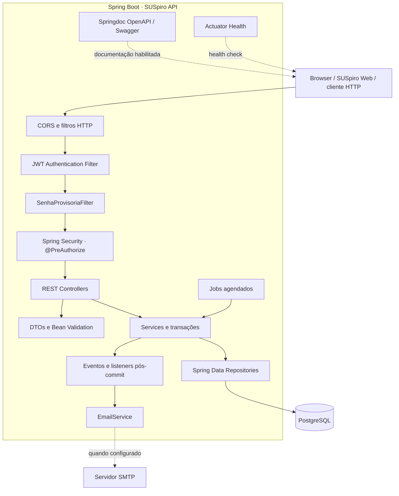

# SUSpiro API

**Backend REST para gestão de pacientes, guias, requisições e fluxos de atendimento.**

O SUSpiro API é o serviço responsável por executar as regras de negócio, autenticar usuários, autorizar operações por perfil, persistir dados relacionais e coordenar notificações do ecossistema SUSpiro. A aplicação é construída em Java 21 e Spring Boot, utiliza PostgreSQL como banco transacional e Flyway para versionamento do esquema.

> **Limite de responsabilidade:** este repositório contém a API e suas rotinas de servidor. A interface web está no repositório [SUSpiro Web](https://github.com/SUSpiro-api/SUSpiro-Api-FrontEnd). O backend é a autoridade para autenticação, autorização, validação de regras de negócio e persistência. Controles visuais do frontend não substituem as proteções deste serviço.

## Visão do serviço

| Item | Referência |
|---|---|
| Serviço | SUSpiro API |
| Repositório | [SUSpiro-Api-BackEnd](https://github.com/SUSpiro-api/SUSpiro-Api-BackEnd) |
| API de produção configurada | [suspiro-api-backend.onrender.com](https://suspiro-api-backend.onrender.com) |
| Health check | [`/actuator/health`](https://suspiro-api-backend.onrender.com/actuator/health) |
| Swagger UI | [`/swagger-ui.html`](https://suspiro-api-backend.onrender.com/swagger-ui.html) — depende de `SWAGGER_ENABLED=true` |
| OpenAPI JSON | [`/api-docs`](https://suspiro-api-backend.onrender.com/api-docs) — depende de `SWAGGER_ENABLED=true` |
| Aplicação web | [suspiro-flax.vercel.app](https://suspiro-flax.vercel.app/) |
| Runtime | Java 21 |
| Framework | Spring Boot 4.1.0 |
| Build | Maven Wrapper 3.3.4 / Maven 3.9.16 |
| Persistência | PostgreSQL + Spring Data JPA |
| Evolução do banco | Flyway (`V1` a `V20`) |
| Deploy de referência | Render, com imagem Docker |

Os endereços representam a configuração de referência do projeto. A disponibilidade efetiva depende do estado dos serviços e das variáveis configuradas no ambiente.

## Responsabilidades e capacidades

- Autenticar usuários por CPF e senha e emitir tokens JWT.
- Gerenciar sessões, logout, troca de senha, primeiro acesso e recuperação de credenciais.
- Aplicar autorização por perfil e regras de visibilidade no servidor.
- Cadastrar, pesquisar e atualizar pacientes e contas de acesso.
- Emitir, consultar e agendar guias de consulta, retorno, exame e encaminhamento.
- Criar, consultar, agendar, concluir e acompanhar requisições.
- Expor consulta pública de acompanhamento mediante protocolo e CPF.
- Persistir dados em PostgreSQL e evoluir o esquema por migrações Flyway.
- Enviar credenciais e notificações por SMTP quando a integração estiver configurada.
- Executar rotinas agendadas para reprocessamento de notificações e vencimento de requisições.

## Arquitetura em alto nível



A implementação segue uma arquitetura em camadas, com separação entre transporte HTTP, contratos, regras de negócio e persistência. Eventos e tarefas agendadas complementam os fluxos síncronos. Consulte [Arquitetura](docs/architecture.md) para responsabilidades, sequências e limites de cada componente.

## Stack e versões declaradas

| Tecnologia | Versão / configuração | Responsabilidade |
|---|---:|---|
| Java | 21 | Runtime e linguagem |
| Spring Boot | 4.1.0 | Inicialização e composição da aplicação |
| Spring Security | Gerenciada pelo Spring Boot | Autenticação e autorização |
| Spring Web MVC | Gerenciada pelo Spring Boot | API HTTP/REST |
| Spring Data JPA / Hibernate | Gerenciada pelo Spring Boot | Persistência e mapeamento objeto-relacional |
| PostgreSQL | `16-alpine` no Docker Compose | Banco relacional |
| Flyway | Starter Spring Boot + driver PostgreSQL | Migrações versionadas |
| JJWT | 0.12.6 | Emissão e validação de JWT |
| Springdoc OpenAPI | 3.1.1 | OpenAPI e Swagger UI |
| Jakarta Bean Validation | Gerenciada pelo Spring Boot | Validação dos contratos HTTP |
| Spring Mail | Gerenciada pelo Spring Boot | Envio de e-mail |
| Spring Boot Actuator | Gerenciada pelo Spring Boot | Health check |
| Maven Wrapper | 3.3.4 / distribuição Maven 3.9.16 | Build reproduzível |
| Docker | Multi-stage | Empacotamento do runtime |

As versões efetivamente resolvidas são determinadas pelo `pom.xml` e pelo Maven Wrapper deste repositório.

## Começar em ambiente local

### Requisitos

- JDK 21 instalado e disponível em `JAVA_HOME`/`PATH`.
- Git.
- Docker Desktop com Docker Compose **ou** PostgreSQL compatível instalado localmente.
- Acesso à internet na primeira execução do Maven Wrapper para baixar a distribuição e as dependências.

### 1. Obter o código

```bash
git clone https://github.com/SUSpiro-api/SUSpiro-Api-BackEnd.git
cd SUSpiro-Api-BackEnd
```

### 2. Preparar as variáveis

Git Bash, Linux ou macOS:

```bash
cp .env.exemplo .env
```

Windows PowerShell:

```powershell
Copy-Item .env.exemplo .env
```

Edite o `.env`. Para executar localmente, confira ao menos:

```dotenv
DB_HOST=localhost
DB_PORT=5432
DB_NAME=suspiro_central
DB_USER=postgres
DB_PASSWORD=sua_senha_local

JWT_SECRET=gere_um_segredo_aleatorio_com_pelo_menos_32_bytes
JWT_EXPIRATION=86400000
FRONTEND_URL=http://localhost:5173
FRONTEND_BASE_URL=http://localhost:5173

SUPER_ADMIN_CPF=cpf_valido_de_desenvolvimento
SUPER_ADMIN_NOME=Administrador Local
SUPER_ADMIN_PASSWORD=uma_senha_forte_com_12_ou_mais_caracteres

SWAGGER_ENABLED=true
APP_SWAGGER_SERVER_URL=http://localhost:8080
```

Use apenas dados fictícios. Gere um segredo JWT aleatório; não copie o texto ilustrativo acima como segredo real. `FRONTEND_URL` é obrigatória para a configuração CORS. O `.env` é ignorado pelo Git e não deve ser versionado.

A lista completa de variáveis e seus padrões está em [Configuração](docs/configuration.md).

### 3. Iniciar o PostgreSQL

**Opção A — Docker Compose (banco e API):** depois de preencher o `.env`, execute:

```bash
docker compose up --build -d
```

Acompanhe a inicialização:

```bash
docker compose logs -f app
```

**Opção B — PostgreSQL externo/local:** inicie o banco, crie `DB_NAME` e execute a aplicação:

```bash
./mvnw spring-boot:run
```

No Windows PowerShell:

```powershell
.\mvnw.cmd spring-boot:run
```

O `DotenvLoader` carrega `.env` durante a inicialização. O serviço escuta em `0.0.0.0` e utiliza `SERVER_PORT` localmente (padrão `8080`); quando presente, `PORT` tem precedência.

### 4. Verificar a API

- Health: `http://localhost:8080/actuator/health`
- Swagger UI: `http://localhost:8080/swagger-ui.html` (com `SWAGGER_ENABLED=true`)
- OpenAPI JSON: `http://localhost:8080/api-docs` (com `SWAGGER_ENABLED=true`)

O Flyway aplica as migrações na inicialização. O Hibernate usa `ddl-auto: validate`, portanto valida o mapeamento e não cria nem atualiza o esquema automaticamente.

## Comandos de engenharia

| Comando | Finalidade |
|---|---|
| `./mvnw spring-boot:run` | Executar a API localmente |
| `./mvnw test` | Executar a suíte de testes configurada |
| `./mvnw clean verify` | Limpar, compilar, testar e verificar o ciclo Maven |
| `./mvnw clean package` | Gerar o artefato JAR |
| `docker compose up --build -d` | Construir e iniciar a API e o PostgreSQL local |
| `docker compose logs -f app` | Acompanhar logs da API no Compose |
| `docker compose down` | Parar os containers, preservando o volume |
| `docker compose down -v` | Parar os containers e **apagar o volume local do banco** |

PowerShell utiliza `\.\mvnw.cmd` no lugar de `./mvnw`. Execute a suíte antes do deploy: o Dockerfile usa `-DskipTests` na etapa de construção da imagem.

## Contrato da API

A API não possui prefixo global `/api`. Os caminhos são relativos à raiz do domínio do backend. A versão OpenAPI é identificada como `v1` na configuração do projeto.

| Domínio | Operações principais |
|---|---|
| Autenticação | Login, logout, recuperação e redefinição de senha |
| Segurança da conta | Troca de senha e primeiro acesso |
| Usuários | Cadastro, listagem e dados da própria conta |
| Pacientes | Cadastro, pesquisa, consulta e atualização |
| Guias | Emissão, consulta, fila de pendências e agendamento |
| Requisições | Cadastro, listagem, consulta, agendamento e conclusão |
| Consulta pública | Acompanhamento por protocolo e CPF |

A referência completa das **31 operações REST** e das permissões declaradas está em [Referência da API](docs/api-reference.md). O Swagger, quando habilitado, apresenta os schemas, parâmetros e respostas do build em execução.

## Identidade, autenticação e autorização

Os perfis definidos no domínio são `SUPER_ADMIN`, `GERENTE`, `MEDICO`, `ENFERMEIRO`, `ATENDENTE` e `PACIENTE`. As permissões são aplicadas no backend com Spring Security e `@PreAuthorize`; regras de visibilidade também são verificadas nos services.

Controles identificados na implementação:

- Senhas codificadas com BCrypt.
- JWT enviado como `Authorization: Bearer <token>`.
- Revogação de tokens por versão de sessão persistida.
- Senha provisória com fluxo restrito de primeiro acesso.
- Recuperação por token de uso único, armazenado como hash e com expiração.
- Bloqueio de conta após tentativas inválidas, persistido no banco.
- Limites adicionais por IP em operações públicas/sensíveis.
- Cabeçalhos `no-store` e proteção contra cache em respostas com dados sensíveis.

Leia [Segurança e privacidade](docs/security.md). Esta documentação descreve controles observados no código; não representa auditoria independente nem declaração de conformidade legal.

## Persistência e evolução do esquema

O PostgreSQL mantém usuários, pacientes, guias, requisições e agendamentos. As 20 migrações do Flyway ficam em `src/main/resources/db/migration`.

Regras estruturais importantes:

- `pacientes.id` utiliza UUID; IDs de usuários, guias, requisições e agendamentos são numéricos.
- Uma conta de paciente pode manter vínculo opcional com o cadastro persistente do paciente.
- Uma requisição pode ter no máximo um registro de agendamento.
- Guias preservam dados históricos do estabelecimento informado no agendamento; o cadastro dinâmico de estabelecimentos foi removido na migração `V17`.
- Não edite migrações já aplicadas em ambientes compartilhados; acrescente uma nova versão sequencial.

O modelo e o histórico estão em [Banco de dados](docs/database.md).

## Processamento assíncrono e notificações

O backend combina eventos publicados após operações transacionais com listeners executados após o commit. Há rotinas agendadas para:

- lembretes de guias aguardando agendamento;
- reprocessamento de confirmações de agendamento;
- notificações e lembretes de requisições;
- atualização do status de requisições pendentes cujo vencimento passou.

A entrega de mensagens depende das credenciais SMTP. Falhas e tentativas são registradas para permitir reprocessamento conforme as rotinas implementadas. Consulte [Arquitetura](docs/architecture.md) e [Operação](docs/deployment-and-operations.md).

## Ambientes publicados e integração

| Componente | URL |
|---|---|
| API | [https://suspiro-api-backend.onrender.com](https://suspiro-api-backend.onrender.com) |
| Health check | [https://suspiro-api-backend.onrender.com/actuator/health](https://suspiro-api-backend.onrender.com/actuator/health) |
| Swagger UI | [https://suspiro-api-backend.onrender.com/swagger-ui.html](https://suspiro-api-backend.onrender.com/swagger-ui.html) — requer Swagger habilitado |
| OpenAPI JSON | [https://suspiro-api-backend.onrender.com/api-docs](https://suspiro-api-backend.onrender.com/api-docs) — requer Swagger habilitado |
| SUSpiro Web | [https://suspiro-flax.vercel.app](https://suspiro-flax.vercel.app) |

O frontend chama o backend diretamente no navegador em produção. Configure `FRONTEND_URL` com a origem HTTPS exata da Vercel e `VITE_API_URL` no frontend com a URL base do backend, sem adicionar `/api`. Instruções de implantação estão em [Deploy e operação](docs/deployment-and-operations.md).

## Documentação de engenharia

| Documento | Conteúdo |
|---|---|
| [Índice da documentação](docs/README.md) | Mapa de leitura e público-alvo |
| [Arquitetura](docs/architecture.md) | Componentes, responsabilidades, fluxos, eventos e jobs |
| [Referência da API](docs/api-reference.md) | Endpoints, perfis, filtros, estados e códigos HTTP |
| [Banco de dados](docs/database.md) | ERD, tabelas, relacionamentos e migrações |
| [Segurança e privacidade](docs/security.md) | JWT, primeiro acesso, rate limiting, CORS e dados sensíveis |
| [Configuração](docs/configuration.md) | Variáveis e parâmetros por ambiente |
| [Testes e qualidade](docs/testing.md) | Suíte, banco de testes e pipeline local |
| [Deploy e operação](docs/deployment-and-operations.md) | Docker, Render, health checks e rotinas |
| [Solução de problemas](docs/troubleshooting.md) | Diagnóstico de falhas comuns |
| [Contribuição](CONTRIBUTING.md) | Fluxo de trabalho e critérios de revisão |
| [Política de segurança](SECURITY.md) | Tratamento responsável de vulnerabilidades |

## Princípios para manutenção

1. Regras de negócio e autorização devem permanecer no backend.
2. Controllers devem expor DTOs, não entidades JPA.
3. Toda alteração de esquema deve ser uma nova migração Flyway.
4. Operações que envolvem paciente devem derivar identidade e vínculos de fontes confiáveis do servidor; não confiar em CPF/nome fornecidos pelo cliente quando o contrato usa `pacienteId`.
5. Logs não devem incluir CPF completo, senha, JWT, tokens de recuperação ou payloads clínicos.
6. Testes de integração devem usar banco separado de desenvolvimento e produção.
7. Mudanças que alterem contratos HTTP devem atualizar o Swagger e a documentação de integração do frontend.

## Status e limites conhecidos

- O repositório contém o backend e as configurações Docker/Compose; a execução e os testes precisam ser validados no ambiente de destino.
- O Dockerfile compila o artefato com testes ignorados; testes devem ser executados separadamente antes da publicação.
- O limitador adicional por IP utiliza memória local da instância. Em ambientes com múltiplas instâncias, reinícios ou proxy reverso, avalie rate limiting de borda ou compartilhado.
- O envio de e-mail depende de SMTP e do funcionamento do provedor externo.
- O Swagger fica desabilitado por padrão e, quando habilitado, sua UI e especificação ficam acessíveis sem JWT; as rotas de negócio mantêm suas regras de autenticação e autorização.

Esses pontos devem ser considerados no planejamento de capacidade, segurança e operação. A presença de Docker, JWT, CORS ou Swagger, isoladamente, não constitui certificação de prontidão para produção.
